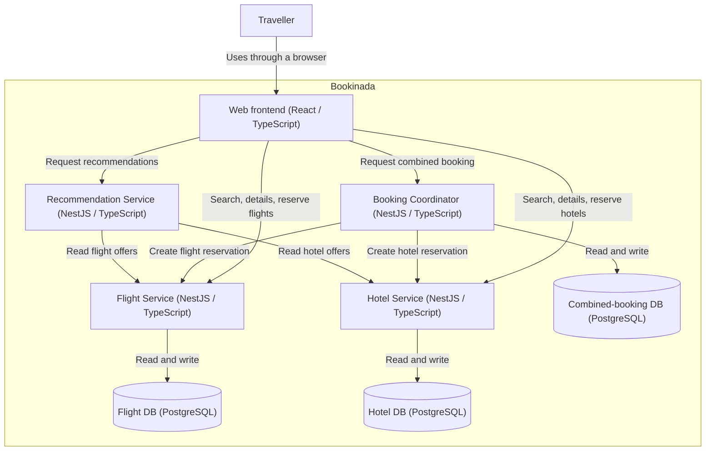

# Bookinada Architecture

## Component responsibilities

The responsibilities below are mapped to the proposed deployment units in the Deployment design section.

| Component              | Responsibilities                                                                                                                                                                                                                                       | Outside its responsibility                                                                                        |
| ---------------------- | ------------------------------------------------------------------------------------------------------------------------------------------------------------------------------------------------------------------------------------------------------ | ----------------------------------------------------------------------------------------------------------------- |
| Flight Service         | Manages flight offers, seat inventory, and flight reservations. Provides offer search, offer details, and reservation creation.                                                                                                                        | Hotel inventory and overall combined-booking status.                                                              |
| Hotel Service          | Manages accommodation offers, room-type inventory for each stay date, and hotel reservations. Provides offer search, offer details, and reservation creation. Checks availability for every night of the requested stay.                               | Flight inventory and overall combined-booking status.                                                             |
| Booking Coordinator    | Coordinates combined flight-and-hotel bookings by calling the Flight and Hotel services. Records each reservation's outcome and manages the overall booking status. Reports a combined booking as confirmed only when both reservations are confirmed. | Direct modification of flight or hotel inventory. Inventory checks and updates belong to the respective services. |
| Recommendation Service | Recommends accommodation based on a selected flight and flights based on accommodation preferences. Uses offer information obtained through the Flight and Hotel service APIs.                                                                         | Creating reservations, modifying inventory, and managing combined-booking status.                                 |

## Communication relationships

The initial design proposes synchronous HTTP APIs with JSON payloads.
Exact endpoints and response schemas will be defined in the API contracts.

| Caller                 | Provider       | Purpose                                                                |
| ---------------------- | -------------- | ---------------------------------------------------------------------- |
| Booking Coordinator    | Flight Service | Requests flight reservations and receives their outcomes.              |
| Booking Coordinator    | Hotel Service  | Requests hotel reservations and receives their outcomes.               |
| Recommendation Service | Flight Service | Retrieves flight offers and details needed for recommendations.        |
| Recommendation Service | Hotel Service  | Retrieves accommodation offers and details needed for recommendations. |

## Data ownership

- Flight Service owns flight offers, seat inventory, and flight reservations.
- Hotel Service owns accommodation offers, room-type inventory per stay date, and hotel reservations.
- Booking Coordinator owns combined-booking records, references to individual reservations, and overall booking status.
- Recommendation Service obtains offer information through service APIs and does not directly access other services' databases.

Each service controls access to its own data. The initial database deployment is described below.

## Deployment design

Status: proposed learning architecture; not yet implemented.

| Deployment unit        | Technology                      | Purpose                                                                                |
| ---------------------- | ------------------------------- | -------------------------------------------------------------------------------------- |
| Web frontend           | React and TypeScript            | Provides search, reservation, combined-booking, and recommendation screens.            |
| Flight Service         | NestJS, Node.js, and TypeScript | Runs the flight API as an independent backend application.                             |
| Hotel Service          | NestJS, Node.js, and TypeScript | Runs the hotel API as an independent backend application.                              |
| Booking Coordinator    | NestJS, Node.js, and TypeScript | Runs the combined-booking API as an independent backend application.                   |
| Recommendation Service | NestJS, Node.js, and TypeScript | Runs the recommendation API; initially uses rules rather than an external AI provider. |

Flight Service, Hotel Service, and Booking Coordinator each own a separate PostgreSQL database. For local development, these databases may share one PostgreSQL instance, using separate credentials and access permissions.

Recommendation Service initially has no persistent database.

## Architectural trade-off

We choose independent backend applications instead of a modular monolith to practise API boundaries, independent deployment, and partial-failure handling.

This introduces additional processes, configuration, network latency, and failure scenarios. We accept this complexity for the course project.

Sharing one PostgreSQL instance reduces local setup overhead but creates a shared infrastructure dependency. Separate database ownership does not provide complete failure isolation.

## Container diagram

Status: proposed architecture; not yet implemented.

Application-to-application calls use synchronous HTTP with JSON.
Database access uses SQL. Arrows point from caller to provider;
responses are implicit.

The three logical databases may share one PostgreSQL instance locally.
Notification delivery and the future blockchain alternative remain
outside the scope of this initial internal design and require refinement.
