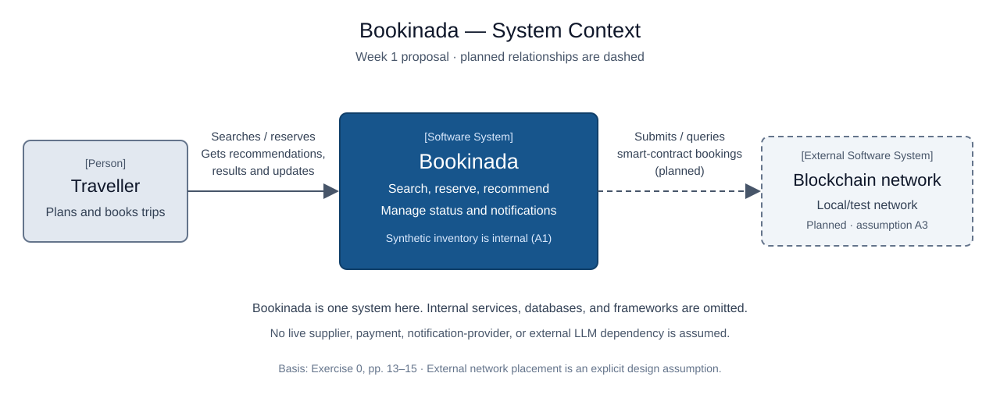

# Bookinada system context — Week 1 proposal

Source: Exercise Sheet 0, Exercise 8, PDF pp. 14–15. Method: [official C4 System Context guidance](https://c4model.com/diagrams/system-context).

Status: assistant-refined at the learner's request. Learner approval and independent peer review remain pending. The diagram describes the proposed system, not an implemented deployment.

[Editable draw.io diagram](system-context.drawio)

## Reading the diagram

- Traveller is the primary user, outside the software-system boundary.
- Bookinada is one software system at this level: search, booking, recommendations, reservation status, and notifications are inside its boundary.
- A local/test blockchain network is a planned external software dependency under assumption A3. The future blockchain adapter belongs inside Bookinada; the network belongs outside it.
- The Traveller-to-Bookinada relationship means the traveller uses the platform to search, reserve, receive recommendations, and view results/status updates; it does not specify a network protocol.

The dashed blockchain relationship is planned, not implemented. It does not make the Week 1 prototype depend on a running blockchain network.

## Boundary decisions

| Responsibility or element | Inside/outside Bookinada | Basis |
| --- | --- | --- |
| Flight and hotel search/reservations | Inside | Course scenario. |
| Synthetic flight/hotel inventory | Inside | A1, an explicit learning assumption. |
| Booking coordination and status tracking | Inside | Combined bookings and partial failures in the scenario. |
| Recommendation logic | Inside | Scenario; implementation/provider not yet selected. |
| Initial in-app notifications | Inside | A4. |
| Future local/test blockchain network | Outside, planned | A3 and scenario's blockchain alternative. |
| Traveller | Outside, person | Primary user. |

FR1–FR8 are responsibilities of the Bookinada system. FR2's date validation and availability filtering happen inside this boundary, using synthetic inventory under A1. C1 motivates the future blockchain relationship, while A3 explicitly chooses a separate network. A4 keeps initial notification delivery inside the application. NFR1–NFR3 constrain the quality of these responsibilities; they are not extra external systems.

Business management is a stakeholder requesting change; no management UI or admin actor is invented here. Real airline APIs, hotel supplier APIs, payment providers, email/SMS services, and external LLM APIs are not established dependencies in this draft.

## Why no React, service boxes, or database here?

A C4 System Context diagram explains the system, people, and external systems. React, Spring Boot services, and databases are internal implementation details to consider at later diagram levels. An independently running hotel service can still belong to Bookinada.

Week 1 does not choose the internal service decomposition, implement a blockchain connection, or require live supplier APIs. The C4 Container Diagram and Flight/Hotel API contracts are tasks for Exercise Sheet 1.

## Review prompts

1. Can you explain why the hotel service is internal but the planned blockchain network is external?
2. If we add an external hotel supplier later, which assumption, diagram relationship, and requirements need revision?
3. Does the diagram imply a dependency that the scenario never established?
